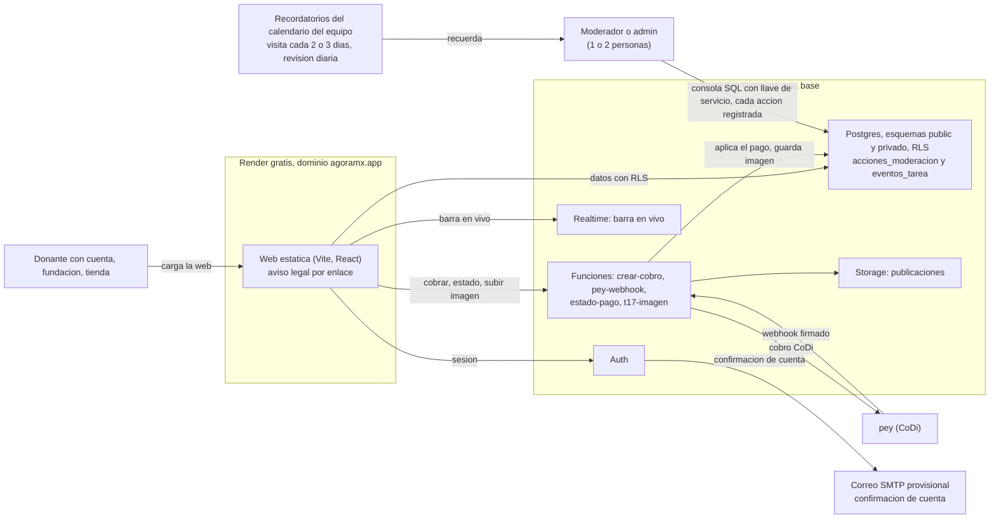

# Arquitectura objetivo de Ágora

Cómo debe estar armada Ágora para operar con fundaciones, tiendas y donantes reales: dónde vive cada pieza, cómo se conectan, cómo se opera y qué se dejó provisional a propósito. Versión del 2026-11-26, ajustada el mismo día por AGO-26: D6 queda reemplazada y el flujo de entrega ya no tiene repartidor (detalle en [modelo-datos.md](modelo-datos.md)). Lo no verificado dice "por confirmar".

Hay una versión corta y estructurada para IAs en [arquitectura-objetivo.json](arquitectura-objetivo.json); si difieren, manda el JSON. Esta versión es la parte pública. No incluye secretos, datos de personas ni los hallazgos internos de riesgos abiertos, que se siguen en el tablero del equipo.

## 1. Alcance

- Solo web. No hay app Android ni Google Play (se dejó para después por tiempo).
- Web en Render gratis, con el dominio `agoramx.app`.
- Supabase en plan Free: una sola base, sin ambiente de pruebas y sin respaldos automáticos.
- Lo que quedó provisional se explica en la sección 8 para quien continúe después de la hackatón.

Relación con los demás documentos:

| Documento | Qué responde |
| --- | --- |
| [inventario.md](inventario.md) | Qué piezas existen hoy y su ruta en el repo |
| Este documento | Dónde vive cada pieza, cómo se conectan y cómo se opera |
| Modelo de datos y permisos (`modelo-datos.md`, se publica con AGO-26) | Quién puede ver y hacer qué, y el diagrama de tablas |

## 2. Arquitectura objetivo

## 3. Por capa

| Capa | Estado objetivo |
| --- | --- |
| Web | Vite y React, build estático en Render, redespliegue en cada push a `main`, dominio `agoramx.app`, avisos legales por enlace |
| Supabase | Plan Free: pausa tras 7 días sin actividad, sin respaldos, registros de 1 día, 500 MB de base, 1 GB de archivos, 5 GB de tráfico (páginas oficiales, consulta 2026-11-24). Auditoría en `acciones_moderacion` y `eventos_tarea` |
| Funciones | `crear-cobro`, `pey-webhook`, `estado-pago`, `t17-imagen` |
| pey | Cobro CoDi por QR, notificación push o enlace; reserva de 15 minutos; la tienda es titular del cobro |
| Moderación y alertas | Moderador o admin con revisión diaria y consola SQL; avisos en pantalla y panel |

Flujos clave (el paso a paso va en el documento de recorridos):

- **Dinero.** El donante elige artículos. `crear-cobro` aparta las unidades 15 minutos y crea el cobro en pey con la credencial de la tienda; el monto lo calcula el servidor. pey avisa a `pey-webhook`, que verifica la firma, confirma con pey, aplica el pago una sola vez y emite un folio. El donante, con su cuenta, ve el estado en pantalla con su folio y después en "mis donaciones"; la tienda ve el pedido en su panel y la fundación ve la barra en vivo.
- **Entrega.** La tienda marca el pedido listo cuando se cumple la meta. Una persona de la fundación va a la tienda con su código de recogida y la tienda lo teclea; con eso se cierra la entrega. No hay repartidor ni foto de entrega (MD7 de `modelo-datos.md`).
- **Operación.** Cada día el moderador o admin revisa las alertas de la sección 6; cada 2 o 3 días visita Supabase para que no se pause.

Seguridad y datos: quién puede qué, el diagrama de tablas y los riesgos de seguridad se definen en el documento de modelo de datos y permisos, no aquí.

## 4. Decisiones vigentes de la línea base

| Decisión | Evidencia |
| --- | --- |
| Supabase como base, cuentas, archivos, tiempo real y funciones | [inventario.md](inventario.md), `supabase/config.toml`, `supabase/migrations/` |
| La tienda es titular del cobro | `docs/piloto/carta.md`, `supabase/functions/crear-cobro/README.md` |
| Webhook de pey idempotente (el mismo aviso dos veces no cobra ni crea dos pedidos) | `supabase/functions/pey-webhook/README.md` |
| Reservas atómicas de 15 minutos (completas o nada; si no se paga, se liberan) | `supabase/functions/crear-cobro/README.md` |
| Entrega cerrada con el código de recogida de la fundación (reemplaza la doble confirmación con repartidor, por AGO-26) | `supabase/migrations/20261114210000_recogida_con_codigo.sql`, [modelo-datos.md](modelo-datos.md) (MD7) |

## 5. Decisiones de operación

| Id | Tema | Decisión |
| --- | --- | --- |
| D1 | Mantener activo Supabase Free | Visita manual con recordatorio repetido en el calendario del equipo, a cargo del moderador o admin. Cada 2 o 3 días y siempre en los días de la hackatón (una visita semanal deja casi cero margen antes de los 7 días) |
| D2 | Respaldo de la base | Sin respaldo; límite declarado |
| D3 | Dominio y hosting | Render gratis con `agoramx.app` |
| D4 | Patrón de alertas | Revisión manual diaria con consultas guardadas, en una lista que el equipo abre |
| D5 | Tipos de alertas | A1 a A8 (sección 6) a cargo del moderador o admin |
| D6 | Notificaciones en solo web | Reemplazada por AGO-26 (MD2 de [modelo-datos.md](modelo-datos.md)): donar exige cuenta con correo confirmado. Se mantiene el aviso en pantalla con folio y el seguimiento pasa a "mis donaciones". La tienda y la fundación se enteran en su panel; la fundación también con la barra en vivo. Correo a la tienda como mejora cuando haya correo propio |
| D7 | Claves UUID | Se mantiene UUID v4 y la regla "un identificador nunca es el único permiso"; el folio sigue siendo secuencial |
| D8 | Moderador y administración | Manual, una o dos personas nombradas con la llave de servicio; cada acción queda en `acciones_moderacion`. Si alguien sale, se quita el acceso y se rotan los secretos |
| D9 | Reembolsos y disputas | Sin reembolsos en la plataforma, con canal de contacto visible; ante un pago sin pedido el moderador contacta a la tienda y a quien pagó y anota el caso |
| D10 | Retención y borrado | Los datos de prueba se borran una sola vez por consola. Desde entonces nada se borra, se inhabilita, para poder auditar. El procedimiento de derechos ARCO se ajusta a esa regla |
| D11 | Ambiente de pruebas | No hay; si hace falta, se crea después |
| D12 | Si pey falla | Se mantiene el aviso actual de la web y se detecta con las alertas A1 y A2; si hay varios cobros atascados en un día, el moderador deja de publicar solicitudes con cobro y avisa a las tiendas |
| D13 | Correo de las cuentas | Puente provisional con SMTP de una cuenta de correo del equipo, configurado solo en el panel de Supabase (nunca en el repo). Después, un proveedor de la lista oficial de Supabase con remitente de `agoramx.app` |

## 6. Alertas (a cargo del moderador o admin)

| Id | Tipo | Cómo se detecta hoy | Gravedad |
| --- | --- | --- | --- |
| A1 | Pago no confirmado | Estado del pago pasada la reserva de 15 minutos | Media |
| A2 | Webhook caído o sin llegar | Cobros atascados en "creado" (como A1) | Alta |
| A3 | Pago sin pedido | Pagos pagados sin pedido, o con la marca de tienda suspendida | Alta |
| A4 | Anomalía del webhook | Marcas de anomalía en los metadatos del pago | Alta |
| A5 | Base pausada o caída | Se nota en la visita de D1: la web no carga datos | Crítica |
| A6 | Secretos | Recordatorio de calendario para revisar y rotar | Alta |
| A7 | Entrega sin cerrar | Tareas abiertas o bloqueadas en `eventos_tarea` | Media |
| A8 | Límites del plan Free | Revisión semanal del panel de Supabase | Baja |

## 7. Límites declarados para la entrega

- Sin respaldos automáticos (ni de la base ni de las fotos).
- Base Free mantenida con visita manual; podría pausarse.
- Una sola base, sin ambiente de pruebas.
- Alertas por revisión humana diaria.
- Sin reembolsos en la plataforma.
- El donante ve la confirmación en pantalla y en "mis donaciones" (no recibe correo ni notificaciones).
- Solo web, sin Google Play.
- Web en Render gratis con `agoramx.app`.

## 8. Qué quedó provisional, para quien siga después

| Qué quedó | Qué hacer después |
| --- | --- |
| Supabase Free con pausa | Plan Pro (desde 25 USD al mes, precio oficial consultado el 2026-11-24) o un monitor externo diario gratuito |
| Sin respaldos | Plan Pro (respaldos diarios, 7 días) o un volcado de la base (`supabase db dump`) guardado cifrado fuera del repo, con una restauración probada en local; las fotos no entran |
| Sin ambiente de pruebas | Segundo proyecto de Supabase o ramas, cuando ya no se pueda probar solo en local |
| Alertas manuales | Tabla de alertas con correo al equipo y monitor externo, con más tiendas o cobros |
| Correo por cuenta personal | Proveedor de la lista oficial con dominio verificado, si el piloto crece o el correo falla |
| Render gratuito | Revisar límites, encabezados de seguridad y alertas; comparar con otros servicios si el tráfico o la seguridad lo piden |
| Moderación por SQL | Panel con rol admin y registro obligatorio, con más de dos moderadores |
| Borrado y ARCO | Quitar cascadas y permisos de borrado; ARCO con revisión legal |
| Notificaciones | Correo a tienda, fundación y donante; opcionalmente notificaciones del navegador |
| Sin reembolsos | Regla entre tienda y donante, o reembolso por pey si existe (por confirmar) |
| Android y Google Play | Retomar la app con Capacitor si el piloto funciona |

## 9. Por confirmar

- Qué cuenta como actividad en Supabase Free y cómo se reactiva un proyecto pausado.
- Reintentos del webhook de pey y si pey permite devoluciones.
- Si el panel de la tienda se refresca solo.
- Límite diario de envíos del correo provisional y si los correos caen en spam.
- Si inhabilitar cumple la cancelación que piden los derechos ARCO (asesoría legal).
- Estado de Render (requiere el panel).

## 10. Fuentes

- Repo: [inventario.md](inventario.md), `supabase/migrations/`, `supabase/config.toml`, `supabase/functions/pey-webhook/README.md`, `supabase/functions/crear-cobro/README.md`, `supabase/MODERACION.md`, `docs/piloto/`.
- Páginas oficiales de Supabase, Render, Cloudflare y Netlify, consultadas el 2026-11-24 y el 2026-11-26.
