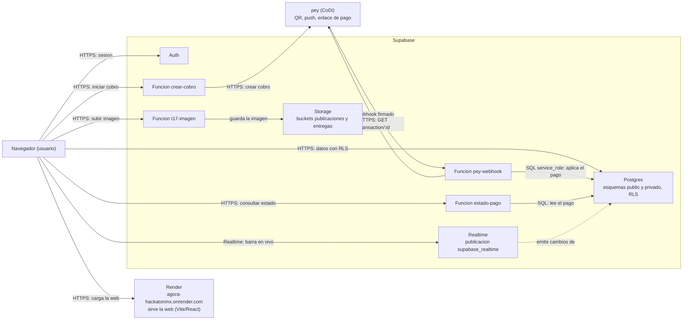

# Inventario de la arquitectura actual de Ágora

Lista de cada pieza que hoy corre (web, Supabase, funciones, Render, pey), su ruta en el repo y cómo se conectan. Es la base de nombres para el resto de los tickets de arquitectura. Describe lo que está en el repo, no decisiones ni motivos (AGO-25), tablas y RLS (AGO-26), secuencias (AGO-27), despliegue (AGO-28) ni riesgos (AGO-29).

Referencia del repo: rama docs/AGO-11-inventario-arquitectura, commit `7df71a1`. Los conteos (16 migraciones, 4 funciones, 15 archivos pgTAP) son sobre esa punta.

Las rutas son relativas a la raíz del repositorio.

## Capa web

Aplicación Vite, React y TypeScript en `web/` (`react ^19.3.1`, `vite ^8.3.6`, `typescript ~7.0.2`, `@supabase/supabase-js ^2.119.0` según `web/package.json`). Mobile-first, tema claro y oscuro (diseño en `web/DESIGN.md`). Enrutado por hash, sin servidor de rutas.

| Componente | Ruta | Qué hace | Quién lo llama |
| --- | --- | --- | --- |
| Punto de entrada | `web/src/main.tsx`, `web/src/App.tsx` | Monta la aplicación y resuelve la pantalla según la ruta | El navegador al cargar `web/index.html` |
| Ruteo por hash | `web/src/lib/router.ts` | Rutas ancla (`#/`, `#/solicitudes`, `#/solicitudes/:id`, `#/siguiendo`, `#/organizaciones/:slug`, `#/sistema`); se apoya en `web/src/auth/role-routes.ts` y `web/src/auth/registro-routes.ts` | `web/src/App.tsx` |
| Cliente de Supabase | `web/src/lib/supabase.ts` | Crea el cliente único con `VITE_SUPABASE_URL` y `VITE_SUPABASE_PUBLISHABLE_KEY`; sin esas variables queda en `null` y la navegación pública sigue funcionando | Toda la app (pantallas, features, auth) |
| Sesión y roles | `web/src/auth/` | Proveedor de sesión, control de acceso por rol (`RequireRole.tsx`), acceso de demostración (`demo.ts`), alta y registro | `web/src/App.tsx` y las pantallas |
| Pantallas públicas | `web/src/screens/Home.tsx`, `Directory.tsx`, `RequestDetail.tsx`, `Following.tsx`, `SystemGallery.tsx` | Portada, directorio, detalle de solicitud, seguimiento de causas, galería del sistema | Ruteo por hash |
| Pantallas de fundación | `web/src/screens/fundacion/` | Área de la fundación: solicitudes, nueva solicitud, recepciones | Ruteo por rol |
| Pantallas de tienda | `web/src/screens/tienda/` | Panel de la tienda: catálogo (con carga CSV), pedidos, recogida con código | Ruteo por rol |
| Pantallas de repartidor | `web/src/screens/repartidor/` | Tareas y entrega (vista parcial según el README del repo) | Ruteo por rol |
| Pantallas de registro | `web/src/screens/registro/` | Alta, inicio de sesión y registro por rol | Ruteo de registro |
| Página de organización | `web/src/screens/organizacion/` | Página pública de la organización con publicaciones (texto, imagen, video) | Ruteo por hash (`#/organizaciones/:slug`) |
| Jornadas | `web/src/screens/jornadas/` | Jornadas de voluntariado (vista de fundación e inscripción) | Ruteo por rol |
| Panel público | `web/src/screens/panel/`, `web/src/screens/Panel.tsx` | Barra en vivo y datos del panel | Ruteo |
| Feature de donación | `web/src/features/requests/Donation.tsx` | Inicia el cobro; invoca la función `crear-cobro` | `RequestDetail.tsx` y el flujo de pago |
| Estado de pago | `web/src/features/requests/PaymentStatus.tsx` | Consulta el estado del pago con un token firmado; invoca `estado-pago` | Flujo de donación |
| Feed de actividad | `web/src/features/feed/` | Lista de eventos de la portada | `Home.tsx` |
| Componentes y UI | `web/src/components/` | Tarjeta e imagen de solicitud, dock del sitio, componentes en `web/src/components/ui/` | Pantallas y features |
| Datos de ejemplo del cliente | `web/src/data/sample.ts` | Datos de muestra para la interfaz | Pantallas |
| Pruebas del cliente | `web/tests/` | Pruebas de `auth` con `node --test` | Verificación local |

El monto de cada cobro lo calcula el backend; el cliente no lo envía. Las credenciales de pey y la llave `service_role` no llegan al cliente.

## Capa Supabase

Postgres con 16 migraciones en `supabase/migrations/` y el esquema `privado` (creado en `20261114120000_modelo_datos.sql`); Auth; Storage; Realtime. Configuración local en `supabase/config.toml`.

| Componente | Ruta | Qué hace | Quién lo llama |
| --- | --- | --- | --- |
| Modelo de datos y Realtime | `supabase/migrations/20261114120000_modelo_datos.sql` | Esquema `privado`, tablas y la publicación `supabase_realtime` sobre `public.solicitud_articulos` (barra en vivo) | Migraciones al aplicar el esquema; Realtime emite a los clientes |
| Políticas de acceso | `supabase/migrations/20261114120100_politicas_acceso.sql` | Políticas por fila (RLS) y privilegios por esquema | Postgres en cada consulta |
| Publicar solicitud | `supabase/migrations/20261114130000_publicar_solicitud.sql` | Función SQL para publicar una solicitud | Pantallas de fundación |
| Panel de la tienda | `supabase/migrations/20261114140000_panel_tienda.sql` | Lógica del panel de la tienda | Pantallas de tienda |
| Publicaciones y Storage `publicaciones` | `supabase/migrations/20261114150000_publicaciones_consentimiento_storage.sql` | Consentimiento al publicar y bucket privado `publicaciones` (JPEG, 5 MiB) | Página de organización, función `t17-imagen` |
| Jornadas de voluntariado | `supabase/migrations/20261114160000_jornadas_voluntariado.sql` | Jornadas, cupos e inscripción | Pantallas de jornadas |
| Tareas del repartidor | `supabase/migrations/20261114170000_tareas_repartidor.sql` | Tareas de recogida y entrega | Pantallas de repartidor |
| Privilegios service_role (T07) | `supabase/migrations/20261114170700_t07_privilegios_service_role.sql` | Ajuste de privilegios para `service_role` | Postgres |
| Entrega y Storage `entregas` | `supabase/migrations/20261114180000_entrega_doble_confirmacion.sql` | Doble confirmación de entrega y bucket privado `entregas` (JPEG, 3 MiB) | Pantallas de repartidor y fundación |
| Panel público | `supabase/migrations/20261114190000_panel_publico.sql` | Datos del panel público | Pantalla de panel |
| Proteger cuentas demo | `supabase/migrations/20261114200000_proteger_cuentas_demo.sql` | Disparador en `auth.users` que fija las cuentas `@demo.agora.test` | Supabase Auth |
| Límites de abuso | `supabase/migrations/20261114203000_limites_abuso.sql` | Límites de uso | Postgres y funciones |
| Recogida con código | `supabase/migrations/20261114210000_recogida_con_codigo.sql` | Recogida de pedidos con código | Pantallas de tienda y repartidor |
| Registro por rol | `supabase/migrations/20261114220000_registro_por_rol.sql` | Registro de cuentas por rol | Pantallas de registro |
| Feed social | `supabase/migrations/20261114230000_feed_social.sql` | Feed de actividad | Feature de feed |
| Imagen de solicitud | `supabase/migrations/20261115010000_imagen_solicitud.sql` | Imagen asociada a la solicitud | Pantallas de fundación |
| Datos de ejemplo y cuentas demo | `supabase/seed.sql` | Precarga organizaciones de ejemplo (`es_ejemplo`) y cuatro cuentas `@demo.agora.test` | `npx supabase start` / `db reset` |
| Reglas de moderación | `supabase/MODERACION.md` | Cómo verifica el equipo con `service_role` | Documentación |
| Pruebas pgTAP | `supabase/tests/database/` | 15 archivos pgTAP: `acceso`, `cuentas_demo`, `demo`, `entregas`, `feed_social`, `imagen_solicitud`, `jornadas`, `limites_abuso`, `panel`, `publicar`, `recogida`, `registro`, `t17`, `tareas`, `tienda` | `npx supabase test db` |

Subsistemas de Supabase que usa el proyecto:

- **Postgres:** esquemas `public` y `privado`, tablas, funciones SQL y RLS de las migraciones.
- **Auth:** cuentas de usuario; las cuatro cuentas de demostración en `supabase/seed.sql`.
- **Storage:** buckets privados `publicaciones` (imágenes de publicaciones) y `entregas` (fotos de entrega).
- **Realtime:** publicación `supabase_realtime` sobre `public.solicitud_articulos`, que mueve la barra en vivo.

`supabase/config.toml` no define `verify_jwt` por función; la verificación de JWT de cada función la fija el flujo de despliegue (AGO-28).

## Capa funciones (Edge Functions de Deno)

Cuatro funciones en `supabase/functions/`, más `supabase/functions/_shared/` con código común. El conteo de funciones es 4 (`crear-cobro`, `pey-webhook`, `estado-pago`, `t17-imagen`); la carpeta `supabase/functions/_shared/` no es una función.

| Función | Ruta | Qué hace | Quién la invoca | Exige sesión |
| --- | --- | --- | --- | --- |
| `crear-cobro` | `supabase/functions/crear-cobro/` | Crea el cobro CoDi en pey (QR `POST /codi/qr`, push `POST /codi/pn`, enlace `POST /payment-link/create`); el servidor calcula el monto | `web/src/features/requests/Donation.tsx` | No (desplegada sin verificación de JWT según el flujo de despliegue) |
| `pey-webhook` | `supabase/functions/pey-webhook/` | Recibe el webhook de pey, valida la firma Standard Webhooks, confirma con `GET /transaction/:id`, aplica el pago una sola vez (idempotente) y emite el comprobante | pey (webhook saliente) | No (se despliega con `--no-verify-jwt`; la autenticación es la firma) |
| `estado-pago` | `supabase/functions/estado-pago/` | Devuelve el estado del pago y el comprobante a partir de un token firmado | `web/src/features/requests/PaymentStatus.tsx` y `web/src/screens/Following.tsx` | No (desplegada sin verificación de JWT según el flujo de despliegue; valida su propio token firmado) |
| `t17-imagen` | `supabase/functions/t17-imagen/` | Recibe una imagen, le quita metadatos y la sube al bucket `publicaciones`; valida la sesión y la organización | `web/src/screens/organizacion/OrganizacionPage.tsx` y `web/src/screens/fundacion/api.ts` | Sí (responde 401 sin `authorization`) |
| Código común | `supabase/functions/_shared/seguimiento.ts` | Firma y verificación de los tokens de seguimiento del comprobante | `crear-cobro` y `estado-pago` | No aplica |

Notas de las funciones de pago:

- El comprobante se guarda en `pagos.metadata.comprobante` con folio `AGORA-0000000`; el token de seguimiento lo firma el secreto `AGORA_SEGUIMIENTO_SECRET` (mismo valor en `crear-cobro` y `estado-pago`).
- `pey-webhook` descarta los datos bancarios del pagador (CLABE, banco, clave de rastreo): no se guardan ni se registran.
- Cada tienda cobra con su propia credencial de pey, guardada como secreto del backend; `tiendas_cobro.credencial_ref` guarda solo el nombre del secreto. Detalle del flujo en `supabase/functions/crear-cobro/README.md`, `supabase/functions/pey-webhook/README.md` y `supabase/functions/estado-pago/README.md`.

## Capa externa

| Componente | Ruta en el repo | Qué hace | Cómo se conecta |
| --- | --- | --- | --- |
| pey (CoDi) | Integración en `supabase/functions/crear-cobro/` y `supabase/functions/pey-webhook/` | API de cobro CoDi: QR, push y enlace de pago; webhook firmado; consulta `GET /transaction/:id` | `crear-cobro` llama a la API de pey por HTTPS; pey envía el webhook firmado a `pey-webhook`; `pey-webhook` confirma cada pago con `GET /transaction/:id` |
| Render (hosting de la web) | Sin archivo en el repo (no hay `render.yaml`) | Sirve la web publicada | URL pública `https://agora-hackatonmx.onrender.com/` (del `README.md`) |

Detalles de Render que no están en el repo (por confirmar con el usuario, requieren acceso al panel de Render):

- Tipo de servicio de Render: por confirmar.
- Rama desplegada: por confirmar.
- Comando de build: por confirmar.
- Variables de entorno configuradas en Render: por confirmar.

## Diagrama

## Scripts y datos auxiliares

| Componente | Ruta | Qué hace |
| --- | --- | --- |
| Restablecer cuentas demo | `scripts/restablecer-cuentas-demo.mjs` | Restablece las cuatro cuentas `@demo.agora.test` con `service_role` (la llave no se guarda en el repo) |
| Semilla | `supabase/seed.sql` | Datos de ejemplo y cuentas de demostración que aplica `npx supabase start` / `db reset` |
| Aplicar datos de ejemplo | `supabase/datos-ejemplo/aplicar.sql` | SQL que carga los datos de ejemplo |
| Subir imágenes de ejemplo | `supabase/datos-ejemplo/subir-imagenes.mjs` | Sube las imágenes de ejemplo a Storage |

Carpeta `supabase/datos-ejemplo/` también incluye `supabase/datos-ejemplo/CREDITOS.md` y la carpeta `supabase/datos-ejemplo/imagenes/`.
