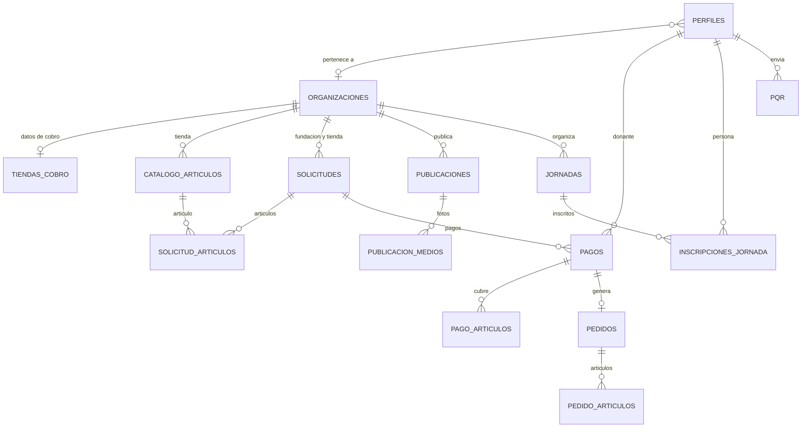

# Modelo de datos y permisos de Ágora

Quién usa Ágora, qué puede ver y hacer cada quien, y cómo se relacionan los datos. Versión del 2026-11-26 (AGO-26). Complementa a [arquitectura-objetivo.md](arquitectura-objetivo.md), que explica dónde vive cada pieza.

Hay una versión corta y estructurada para IAs en [modelo-datos.json](modelo-datos.json); si difieren, manda el JSON. Este documento describe el diseño acordado, es decir, cómo debe quedar Ágora. No dice qué partes ya están construidas: eso se sigue en el tablero del equipo. No incluye secretos, datos de personas ni hallazgos internos de seguridad.

## 1. Roles

Hay 5 tipos de personas con cuenta. Además, la base de datos reconoce a quien entra sin sesión y a una llave del servidor.

| Rol | Quién es | Qué hace |
| --- | --- | --- |
| Donante | Persona con cuenta y correo confirmado | Dona, ve sus comprobantes, comenta, se inscribe a jornadas, envía PQR |
| Fundación | Organización verificada | Publica solicitudes con fecha límite, recoge su pedido en la tienda con su código, publica en el feed, organiza jornadas |
| Tienda | Cuenta de acceso ligada a un negocio verificado | Mantiene su catálogo con stock, prepara pedidos, marca "listo" con la meta cumplida y confirma la recogida |
| Moderador | Persona del equipo de Ágora, en su propia área | Valida altas de fundaciones y tiendas, atiende PQR y reportes de fallos, modera contenido, bloquea cuentas, suspende organizaciones y da de baja cuentas |
| Administración | 1 o 2 personas del equipo de Ágora | Ve informes, asigna tareas a moderadores, da de alta y de baja moderadores, habilita el cobro de tiendas y hace la parte técnica |

No son personas con cuenta:

- **Visitante:** cualquiera sin sesión. Solo mira solicitudes, el feed y el panel público, y puede reportar una publicación.
- **Llave del servidor (`service_role`):** la usan solo las funciones del servidor. Nunca está en la web ni en chats.

El rol **repartidor** se retira. La fundación recoge su pedido en la tienda (sección 3.2). Las jornadas de voluntariado se mantienen: son otra cosa.

## 2. Quién puede qué

**Sí** = puede; **No** = no puede; **n/a** = no aplica. Columnas: Vis = visitante, Don = donante, Fund = fundación, Tien = tienda, Mod = moderador, Adm = administración.

### 2.1 Público y donación

| Acción | Vis | Don | Fund | Tien | Mod | Adm |
| --- | --- | --- | --- | --- | --- | --- |
| Ver solicitudes, feed y panel público | Sí | Sí | Sí | Sí | Sí | Sí |
| Donar | No | Sí | No | No | No | No |
| Ver sus comprobantes y donaciones | No | Sí, los suyos | No | No | No | Sí |
| Comentar, dar me gusta, reportar un comentario | No | Sí | Sí | Sí | Sí | Sí |
| Reportar una publicación | Sí | Sí | Sí | Sí | Sí | Sí |
| Inscribirse a una jornada | No | Sí | Sí | Sí | n/a | n/a |
| Enviar un PQR o un reporte de fallo | No | Sí | Sí | Sí | n/a | n/a |
| Pedir el alta como fundación o tienda | No | Sí, con correo confirmado | n/a | n/a | n/a | n/a |

### 2.2 Fundación

| Acción | Fund | Mod | Adm |
| --- | --- | --- | --- |
| Publicar una solicitud (organización verificada) | Sí | No | No |
| Cancelar su solicitud | Solo sin pagos ni reservas | Sí, con motivo | Sí |
| Editar título y descripción después de la primera donación | No | No | No |
| Editar su ficha pública | Sí, revisable | Sí | Sí |
| Publicar en el feed (con consentimiento de quien aparece) | Sí | No | No |
| Ver pagos y pedidos de sus solicitudes | Sí, solo lo necesario | Sí | Sí |
| Ver el código de recogida de su pedido listo | Sí | No | Sí |
| Gestionar sus jornadas e inscritos | Sí | No | No |

Las demás personas (visitante, donante, tienda) no pueden hacer nada de esta tabla.

### 2.3 Tienda

| Acción | Tien | Mod | Adm |
| --- | --- | --- | --- |
| Gestionar su catálogo y stock (incluye subir CSV) | Sí | No | No |
| Marcar un pedido "listo" | Solo con la meta cumplida o la fecha límite vencida | No | No |
| Confirmar la recogida tecleando el código de la fundación | Sí | No | No |
| Cancelar una solicitud | No | Sí, con motivo | Sí |
| Cambiar sus datos fiscales o de cobro | Pide el cambio | Valida | Sí |
| Ver el código de recogida | No | No | Sí |

### 2.4 Moderación y administración

| Acción | Mod | Adm |
| --- | --- | --- |
| Aprobar o rechazar altas de fundaciones y tiendas | Sí | Sí |
| Atender PQR y reportes de fallos | Sí | Sí |
| Suspender o invalidar una organización | Sí, con motivo | Sí |
| Retirar contenido; ocultar o restaurar comentarios | Sí | Sí |
| Bloquear o desbloquear cuentas | Sí | Sí |
| Dar de baja una cuenta (baja lógica) | Sí, con motivo | Sí |
| Ver datos de contacto de otras personas | Solo lo necesario, con registro | Solo lo necesario, con registro |
| Ver informes y asignar tareas a moderadores | No | Sí |
| Dar de alta o de baja moderadores | No | Sí |
| Habilitar el cobro de una tienda | Valida | Sí |
| Rotar llaves y borrar archivos de forma definitiva | No | Sí |

Cada acción de moderación y administración queda registrada con la cuenta que la hizo y el motivo. Un bloqueo corta toda la actividad de la cuenta: donar, publicar y operar. Una persona que da de baja su propia cuenta lo pide a moderación.

## 3. Reglas del flujo

### 3.1 Solicitud, meta y fecha límite

| Momento de la solicitud | Quién puede cancelar | ¿La tienda puede marcar "listo"? |
| --- | --- | --- |
| Borrador | La fundación | No aplica |
| Publicada, sin pagos ni reservas | La fundación | No |
| Publicada, con al menos un pago | Solo moderación, con motivo | No |
| Meta cumplida | Solo moderación, con motivo | Sí; la solicitud se cierra sola |
| Fecha límite vencida sin meta | Se cierra sola | Sí, solo con lo pagado |

- La fundación pone la fecha límite de cada solicitud, sin pasar del máximo que fija el equipo de Ágora.
- Si moderación cancela una solicitud con pagos, la tienda entrega lo pagado.
- No hay reembolsos (AGO-25, D9).
- Si una tienda cobra y no entrega, moderación invalida su cuenta. Ágora no responde por ese dinero: la devolución es entre la persona y la tienda, como dicen los términos.

### 3.2 Recogida por la fundación

1. Con el pedido listo, la fundación ve en su panel el código de recogida.
2. Una persona de la fundación va a la tienda y muestra el código.
3. La tienda teclea el código y con eso se cierra la entrega. Varios intentos fallidos bloquean el código.
4. No hay foto de entrega ni segundo código: la confirmación de la tienda con el código es la prueba.

### 3.3 Inventario de la tienda

- El catálogo y el CSV de la tienda incluyen el stock declarado de cada artículo.
- Una solicitud puede pedir como máximo un porcentaje del stock declarado de cada artículo, para que la tienda siga vendiendo. El porcentaje lo fija el equipo de Ágora.
- Lo ya pedido en solicitudes abiertas se resta del stock declarado.
- Al cumplirse la meta, la tienda confirma que tiene todo antes de marcar "listo".
- Cada solicitud tiene una sola tienda.

### 3.4 Registro de la tienda en dos pasos

1. Se crea la cuenta y se confirma el correo.
2. Se registra el negocio: por un lado los datos públicos y, por otro, los datos fiscales y de cobro, que solo ven moderación y administración.

Así un negocio puede cambiar de persona responsable o tener más de una cuenta sin rehacer su registro.

### 3.5 Fotos

- Viven en Supabase Storage, en espacios privados, y se muestran con enlaces temporales. Nunca están en una carpeta pública de la web.
- Antes de guardarse se les quitan los metadatos (incluida la ubicación).
- Máximo 4 fotos por publicación y 10 por organización al día.
- No hay foto de entrega.

### 3.6 Nada se borra: se inhabilita

Regla de AGO-25 (D10). Las filas se inhabilitan con fecha y motivo. Los pagos y pedidos nunca se borran. Los archivos de fotos sí se borran de verdad, porque son el dato personal y ocupan espacio:

| Foto | Cuándo se borra el archivo |
| --- | --- |
| Portada de una solicitud | 1 semana después de entregado el pedido; la solicitud queda sin foto |
| Retirada por falta de consentimiento o por un reporte | 30 días |
| Inhabilitada por otro motivo | 12 meses |

Los plazos están por confirmar con la revisión legal (AGO-45).

## 4. Datos personales

- Ninguna organización ve los datos de contacto de otra ni los del donante.
- Una fundación ve los datos de quienes se inscriben a sus jornadas.
- Moderación y administración ven solo lo necesario para decidir un alta o atender un reporte o un PQR, y cada consulta queda registrada.
- La cuenta del donante guarda lo mínimo para donar y ver sus comprobantes. El aviso de privacidad se actualiza en AGO-45.

## 5. Tablas

Una sola base de Supabase (AGO-25). Las tablas se agrupan así:

| Grupo | Tablas | Nota |
| --- | --- | --- |
| Cuentas y organizaciones | `perfiles`, `organizaciones`, `tiendas_cobro`, `solicitudes_alta`, `usuarios_bloqueados` | La cuenta (`perfiles`) va separada del negocio (`organizaciones`) y de sus datos de cobro (`tiendas_cobro`) |
| Dinero y pedidos | `catalogo_articulos`, `solicitudes`, `solicitud_articulos`, `pagos`, `pago_articulos`, `pedidos`, `pedido_articulos` | El catálogo suma stock; las solicitudes suman fecha límite; los pagos quedan ligados a la cuenta del donante |
| Contenido | `publicaciones`, `publicacion_medios`, `reportes`, `comentarios`, `reportes_comentario`, `me_gusta`, `jornadas`, `inscripciones_jornada` | Las inscripciones quedan ligadas a una cuenta |
| Moderación | `acciones_moderacion`, moderadores, PQR | La tabla de PQR es nueva |
| Se retiran con el repartidor | `tareas`, `entregas`, `eventos_tarea` y el espacio de fotos de entrega | La recogida queda en `pedidos` |

## 6. Decisiones

| Id | Tema | Decisión | Cambia |
| --- | --- | --- | --- |
| MD1 | Datos de contacto | Solo moderación y administración, solo lo necesario, con registro de cada consulta | |
| MD2 | Cuenta del donante | Cuenta obligatoria para donar, antes del 12 dic | Reemplaza AGO-25 D6 (donante sin cuenta) |
| MD3 | Inscripción a jornadas | Con la misma cuenta del donante | |
| MD4 | Inventario | Stock en el CSV, tope por porcentaje del stock y resta de lo ya pedido; la tienda confirma al cumplirse la meta | Después de la hackatón: conexión por API y solicitudes con varias tiendas |
| MD5 | Meta y fecha límite | Fecha límite por solicitud; al vencer o al cancelar con pagos, la tienda entrega lo pagado; sin reembolsos | |
| MD6 | Fotos | Sin foto de entrega; 4 por publicación y 10 por organización al día; borrado del archivo por plazos | Plazos por confirmar con AGO-45 |
| MD7 | Repartidor | Se retira; la fundación recoge con su código | Cambia el flujo de entrega de AGO-25 |
| MD8 | Registro de tienda | En dos pasos: cuenta, luego negocio | |

Valores que fija el equipo de Ágora: el porcentaje máximo del stock por solicitud (MD4) y el plazo máximo de la fecha límite (MD5).

## 7. Después de la hackatón

- Conexión por API con el sistema de la tienda para stock en vivo.
- Una solicitud repartida entre varias tiendas.
